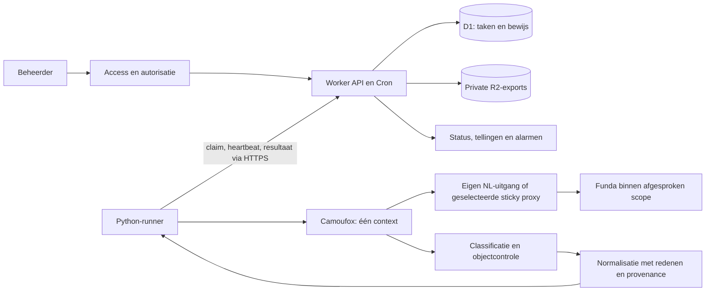

# Ontwerpvoorstel voor betrouwbare Funda-verzameling

Status: voorstel om samen te bespreken, niet goedgekeurd voor uitvoering. Datum: 16 november 2026. Basis: fork/main `96d4e4c`. Dit voorstel bouwt voort op [de research](</Users/maartenesser/reports/Funda scraping met Cloudflare.md>) en [de gemeten reparatie](../../verification.md).

## Mijn aanbeveling

Bouw één bestuurbare verzameldienst met een Cloudflare Worker als regelpunt en één aparte Python-browserrunner op een altijd beschikbare machine. De runner haalt taken zelf op via uitgaande HTTPS. Cloudflare D1 bewaart de voortgang en de resultaten; private R2-objecten bevatten gecontroleerde exports. Access beveiligt beheer en machineverkeer. Cron maakt begrensde opdrachten aan.

Begin met één runner, één browsersessie en een kleine, afgesproken koopregio. Vergelijk toegang via een eigen Nederlandse verbinding en vervolgens eventueel één bevestigde Nederlandse ISP- of sticky residential proxy. Zet Cloudflare Containers pas in nadat dezelfde runner daar aantoonbaar functioneert. Een wachtrijproduct en extra coördinatie zijn vervolgstappen zodra volume of meerdere runners die rechtvaardigen.

Dit ontwerp heeft drie afzonderlijke doelen: herhaalbare toegang meten, inhoudelijk correcte data leveren en fouten zichtbaar en herstelbaar maken. Een werkende infrastructuur garandeert geen toelating door Funda. De latere 403 uit onze live test blijft een onopgeloste toegangsbeperking. Nieuwe Funda-proeven volgen de afgesproken toestemming en scope uit de research; er wordt in deze planfase niets live gescrapet of aangeschaft.

## Wat er al is en wat ontbreekt

De bestaande library heeft een requests- en Camoufox-backend, sessiebehoud, consentafhandeling, DOM-wachten, JSON-LD/kenmerken-extractie, CSV en controles tegen verwarring tussen zoekresultaten en detailpagina’s. Het bestaande testbestand omvat 44 uitgeklapte testgevallen, waarvan één optionele echte browsertest tegen een lokale server. Een groene suite bewijst geen productierijpe verzameldienst.

Er is nog geen proxyconfiguratie, duurzame jobadministratie, hervatten, lease, centraal budget, volledige foutentelling of veilige publicatietransactie. De huidige opschoning kan records met ontbrekende prijs/oppervlakte uit het resultaat filteren. Een zoekredirect wordt als unavailable gerapporteerd, maar bewijst geen verkoop of definitieve verwijdering. CSV wordt rechtstreeks naar het doel geschreven. Deze tekortkomingen worden expliciet onderdeel van het bouwplan.

De service gebruikt daarom een nieuwe expliciete pipeline. De bestaande publieke library-interface blijft compatibel; de service mag een lege opgeschoonde DataFrame nooit als voldoende bewijs voor een lege markt gebruiken.

## Benodigde onderdelen

| Onderdeel | Rol | Keuze |
|---|---|---|
| Python 3.12-runner | Browser, ophalen, classificeren, extractie, normalisatie | Altijd beschikbare eigen NL-host voor eerste toegangsproef; later eventueel Linux-VM met gekozen proxy |
| Worker + Cron | Beheer-API, planning, claimen, resultaten accepteren | Eén TypeScript-service; browsen gebeurt buiten de Worker |
| D1 | Autoriteit voor scopes, runs, URL-statussen, leases en observaties | Uitsluitend de Worker schrijft naar productie-D1 |
| R2 | Private, onveranderlijke exports en manifests | Gekozen voor centrale productie-export; lokale pilot kan atomisch lokaal exporteren |
| Access | Gescheiden beheer- en machine-identiteiten | Worker valideert identiteit en bevoegdheid ook zelf |
| Proxy | Optionele uitgaande netwerkroute | Eerst gemeten baseline; leverancier pas kiezen na kleinschalige vergelijking |
| Tunnel | Eventuele latere beheerverbinding | Niet vereist voor het gekozen pullmodel; geen publieke runner-API |
| Queues / extra DO | Eventuele latere verdeling en coördinatie | Niet nodig bij één D1-gestuurde claimloop; aparte beslissing bij schaalvergroting |
| Containers | Mogelijke latere runtime | Geen voorwaarde voor functionele oplevering; eerst compatibiliteits- en herstarttest |

Cloudflare Browser Run is hier niet de gekozen toegangslaag: het biedt niet de bewezen Camoufox-runtime en eigen authenticated residential proxyondersteuning is niet bevestigd. De selectie volgt uit de research; zij bewijst niet welke uitgang Funda zal accepteren.



De runner is een vertrouwde uitvoerder: schema-/snapshotvalidatie bewijst geen onafhankelijke waarheid van een Funda-bronwaarde die een gecompromitteerde runner verzint. Beheerde host, geverifieerde artifacts en het handmatig vastgestelde bronpanel zijn daarom onderdeel van de gates.

De pijlen betekenen geen toegang voor de runner tot Cloudflare-accountbeheer. Hij krijgt beperkte servicebevoegdheden op de API. Proxycredentials komen uitsluitend lokaal uit de vaultinjectie, niet uit jobs, D1, R2 of exports.

## Bouwgrenzen en bron van waarheid

Vier grenzen houden de code controleerbaar:

1. De library haalt een document op en extraheert bronwaarden. Inkomende HTML blijft tijdelijk in procesgeheugen.
2. De collector classificeert documenten, maakt observaties en past budget-, kwaliteits- en herstelbeleid toe.
3. De Worker administreert taken, claims en geaccepteerde resultaten. Deze controleert opnieuw lease, schema en tellingsregels.
4. De publicatielaag maakt een export pas zichtbaar na validatie. Een gedeeltelijke run vervangt nooit stilzwijgend de laatste gecontroleerde export.

De contracten staan centraal als JSON Schema plus gedeelde voorbeeldpayloads. Python en TypeScript moeten dezelfde geldige en ongeldige voorbeelden accepteren of afwijzen. Elk resultaat bevat een schema-, parser-, normalisatie- en policyversie. Geen LLM wordt gebruikt om ontbrekende woninggegevens te raden.

Voorgestelde repository-indeling:

```text
funda_scraper/                    bestaande library en transportadapters
funda_collector/
  contracts.py                   getypeerde publieke payloads en uitkomsten
  policy.py                      scope, deadlines, budgets en retrybesluiten
  network.py                     netwerkroute en geheime runtime-injectie
  session.py                     browserlevensduur en sessiegrenzen
  classify.py                    documenttype en objectidentiteit
  normalize.py                   waarden, ontbreekredenen en herkomst
  runner.py                      claimloop en gecontroleerd verwerken
  client.py                      beperkte Worker-API-client
  export.py                      lokale atomische exportadapter
contracts/                       JSON Schema en contractvoorbeelden
control/
  cloudflare.config.ts           cf CLI-configuratie
  src/auth.ts                    identiteit en rollen
  src/jobs.ts                    planning, leases en budgetreservering
  src/observations.ts             idempotente resultaten
  src/publication.ts              publicatiestatus en private exports
  src/index.ts                   HTTP/Cron-ingangen
  migrations/                    D1-schema en indexen
  tests/                         Workers/D1/R2-contract- en integratietests
tests/collector/                  Python-unit-, integratie- en fouttests
tests/fixtures/                  synthetische pagina’s; geen live HAR of cookies
ops/                             runbooks, versie-locks en herstelprocedure
```

De package-discovery moet de nieuwe collector expliciet meenemen. Het service-runtimebeleid is Python 3.12; de bestaande library blijft op de huidige 3.9–3.13-matrix getest. Node minimaal 22.18 volgt de gekozen cf CLI. Exacte dependency- en browserassets worden bij implementatie vastgezet met lockfiles, release-URL, artifact-checksum en image-digest. De nu werkende Camoufox/Playwright-combinatie is de startbasis, geen reden om beveiligingsupdates permanent over te slaan.

## Datamodel en levensloop

`Scope` beschrijft markt/regio, toegestane routes, velden, frequentie, rechtenreferentie, netwerkprofiel en limieten. `Job` is een geplande uitvoering voor één scope en tijdslot. Een unieke sleutel op `(scope_id, schedule_slot_utc)` voorkomt dubbel plannen. `Run` is één uitvoeringspoging; hervatten maakt een nieuwe run die dezelfde job en checkpoints voortzet.

D1 bevat verder `url_work` voor elke ontdekte unieke URL, `attempts` voor geredigeerde ophaaluitkomsten, `observations` voor gestructureerde bronwaarden, `listing_aliases` voor bewezen canonieke relaties, en `exports` voor publicatiestatus. Een actuele woningweergave is een afgeleide selectie van de laatste geldige observatie, niet een vernietigende overschrijving van historie. Bewaar ontbreekredenen en waarnemingstijd.

Een claim heeft een oplopend fence-nummer, eigenaar en vervaldatum. Alle collector-heartbeats, discovery-, observatie- en closuremutaties controleren de actuele target-/jobfence. De interne publisher gebruikt na sealing een afzonderlijke exportlease/fence en recovery-epoch. Een fence is een consistentienummer, geen toegangstoken. Authenticatie staat daar los van. Een oude runner kan na leaseverval geen collectiegegevens of closure meer schrijven; hij heeft nooit publisherrechten. Een actuele publisher mag een reeds gesealde snapshot na browserleaseverlies wel afronden. Claim en budgetreservering moeten database-atomisch zijn; eerst SELECT en daarna los UPDATE voldoet niet.

Voorgestelde begininstellingen, te bespreken en te toetsen:

| Instelling | Beginwaarde | Betekenis |
|---|---:|---|
| Gelijktijdige runners voor Funda | 1 | Geen automatische opschaling |
| Contexten/tabs | 1 / 1 | Subresources binnen een pagina blijven wel meerdere requests |
| Navigatie-interval | Minimaal 5 seconden plus 0–2 seconden spreiding | Experimentele bovengrens aan tempo, geen Funda-veiligheidsnorm |
| Navigaties per pilotjob | 25 | Inclusief zoekpagina’s, detailpogingen en retries |
| Pogingen per URL | Maximaal 2 | Tweede poging alleen bij expliciet tijdelijke netwerk-/5xx-fout |
| Browserstart | Maximaal 60 seconden | Apart van paginadeadline |
| Navigatie plus renderen | Samen maximaal 45 seconden | Eén gedeelde deadline, geen losse cumulatieve timers |
| Job | Maximaal 15 minuten | Daarna zichtbaar gestopt met checkpoint |
| Lease / heartbeat | 90 / 15 seconden | Publicatie wordt server-side gefenced |
| Annulering | Binnen 10 seconden geen nieuw werk; proces-kill na begrensde grace | Reeds verzonden netwerkverkeer kan niet worden teruggenomen |
| Betaalde proxyproef | Voorgesteld maximum $25 en maximaal 1 GB | Alleen na expliciete keuze; providerquotum waar beschikbaar, geen automatische top-up |

Een instellingswijziging is geversioneerd en start een nieuwe job met eigen scope-/policy-snapshot; zij reset geen bestaande joblimiet. Een proceslock beschermt daarnaast tegen twee lokaal gestarte browserrunners. De databaselease beschermt tegen overlap tussen machines. Gemiste Cron-slots starten niet onbeperkt inhaalwerk; maximaal één achterstallige job per scope, de rest krijgt een zichtbare skipped-schedule-uitkomst.

## Elke URL krijgt een verklaarbare uitkomst

Een URL heeft exact één huidige toestand: `QUEUED`, `LEASED`, `VALID`, `INCOMPLETE`, `QUARANTINED`, `UNAVAILABLE_OBSERVED`, `SEARCH_REDIRECT`, `BLOCKED`, `FAILED`, `ALIASED` of `CANCELLED`. Het totaal moet altijd gelijk zijn aan de som van deze onderling exclusieve toestanden. Verwerkingspogingen tellen apart: twee retries zijn geen twee woningen.

Een lege zoekpagina is alleen leeg als de parser een geldige lege primaire lijst of een expliciet herkend leeg-resultaatscherm ziet. Een onbekende DOM, een CAPTCHA, een 403 of honderd weggefilterde bronrecords zijn nooit bewijs voor nul woningen.

`UNAVAILABLE_OBSERVED` betekent een gemeten 404/410; `SEARCH_REDIRECT` betekent dat de detailroute herkenbare zoekresultaten teruggaf. Geen van beide verklaart zelfstandig een woning verkocht of verwijderd. Ook niet gevonden tijdens één crawl betekent geen verwijdering. Bewaar de laatst bekende geldige observatie en markeer de actualiteit. Reconciliatie van verwijderingen krijgt een afzonderlijk, later te valideren beleid.

Een run eindigt als `COMPLETE`, `PARTIAL`, `BLOCKED`, `FAILED` of `CANCELLED`. `COMPLETE` betekent uitsluitend dat de benoemde scope is afgewerkt en de afgesproken kwaliteitscontroles slagen; nooit bewezen landelijke volledigheid. `PARTIAL` blijft leesbaar met oorzaken en ontbrekende delen, maar promoveert niet naar `LATEST_VERIFIED`. De manifestregels rekenen alle ontdekte URLs af, inclusief aliases, blokkades en nog niet verwerkte URLs.

## Identiteit, velden en kwaliteit

Elke observatie bewaart requested URL, waargenomen canonieke property-URL, markt, volledige city/address-routekey, bron-ID, canoniek ID, parser- en schemaversie. Canonieke ID-verschillen zijn alleen toegestaan bij een expliciete property-canonical en dezelfde markt/city/volledige adresroute. Een zoekcanonical kan nooit een property zijn, ook niet als de JSON-LD lijst rijke House-objecten bevat. Bij een adresconflict wordt het record in quarantaine gezet, niet gerepareerd door de canonical eroverheen te schrijven.

Voor prijs worden bedrag, valuta en betekenis apart opgeslagen: `ASKING_PRICE`, `LAST_ASKING_PRICE`, `ON_REQUEST` of `UNKNOWN`. Een werkelijke koopsom wordt niet uit een Funda-vraagprijs afgeleid. Huur krijgt later een aparte velddefinitie voor periode en eventuele servicekosten. Prijs op aanvraag is een geldige bronuitkomst met een leeg numeriek bedrag; zij mag niet als nul euro of als parserfout worden behandeld.

Veldresultaten hebben `value`, `source` en `missing_reason`, bijvoorbeeld `NOT_ON_PAGE`, `LOGIN_REQUIRED`, `NOT_APPLICABLE` of `UNPARSEABLE`. Een afgeleide stad uit de zoekopdracht mag geen bronstad voorstellen. Ontbrekend bouwjaar is geen foutief bouwjaar nul. Ontbrekende oppervlakte maakt een oppervlakte-analyse onvolledig, niet het gehele bronobject onbestaand. Geldige observaties worden opgeslagen vóór een eventuele exportspecifieke selectie; afwijzingen krijgen expliciete redenen.

Pilot-exportprofiel: objectidentiteit, adres, markt en gecontroleerde prijsbetekenis zijn vereist; numerieke prijs en oppervlakte zijn nodig voor de subset voor prijs/m². Optionaliteit van bouwjaar, energie en kamers is afzonderlijk zichtbaar. Vrije beschrijvingen, makelaarcontacten, eigenaarnamen en gedownloade foto’s blijven buiten het eerste serviceprofiel. Woningadres en postcode zijn wel doelgebonden brongegevens; dit is geen algemene privacy-complianceclaim.

## Netwerk en herstel

Een `NetworkRoute` noemt een route-ID en credentialreferentie. Geheime gebruikersnamen/wachtwoorden worden pas in het runnerproces geïnjecteerd, nooit in repr, jobpayloads of logs. Eén browsercontext is gebonden aan één route en providersessie. Geen automatische IP-rotatie per request. Als de sticky uitgang onverwacht wisselt, stopt de context gecontroleerd; hervatten gebruikt een nieuwe run/context en een verklaard checkpoint.

Eigen testendpoints controleren uitgang, proxy-authenticatie en mogelijke afwijkingen via DNS, IPv6 en WebRTC. Er wordt geen publieke IP-check per Funda-pagina uitgevoerd. Een goede HTTP-routecheck bewijst geen afwezigheid van andere lekken; dat blijft een expliciete testcategorie.

Tijdelijke netwerkproblemen/5xx krijgen hoogstens één begrensde retry met backoff binnen dezelfde joblimiet. Een 407 is configuratiefout, 401/403 of CAPTCHA is toegangsfout, een 429 krijgt een zichtbaar `not_before` volgens geldig `Retry-After`. Een parserfout hoort bij een aparte driftmelding en wordt niet met nieuwe IP’s bestreden. Bij 403/CAPTCHA opent het Funda-circuit: geen nieuwe Funda-pogingen door andere jobs of routes. Heropenen van een geblokkeerde pilot gebeurt expliciet door beheer, met één canary binnen budget. Dit beleid probeert een blokkade niet blind weg te roteren.

## Publicatie, status en herstelbaarheid

Een export bestaat uit een server-side vastgezette selectie observatieversies, onveranderlijke data-objecten, een manifest met hashes/tellingen, en een D1-publicatierecord. De Worker genereert de export uitsluitend uit die selectie; een runner mag geen willekeurige CSV als bron aanleveren. De interne publisher schrijft eerst naar unieke private sleutels, controleert inhoud tegenover de selectie en finaliseert daarna gefencet de publicatiereferentie in D1. D1 is de autoriteit voor zichtbaarheid. R2 en D1 vormen geen gezamenlijke transactie. Een achtergebleven ongepubliceerd R2-object is opruimbaar; een half bestand mag nooit de laatste goede export vervangen.

Beperk exportdelen tot 8 MiB; de manifestlijst beschrijft volgorde, rijen en SHA-256 per deel. Een ontbrekend deel of uploadfout voorkomt publicatie. Een lokale export gebruikt tijdelijk bestand op hetzelfde filesystem en atomische vervanging; op een fout blijft de vorige geldige export intact. CSV-cellen met spreadsheetformules worden veilig als tekst geëxporteerd, zonder de opgeslagen bronwaarde te veranderen.

De beheer-API biedt status per run met vijf blokken: toegang, verwerking, datakwaliteit, dekking en kosten. Toon teller, noemer, laatste waarneming, oorzaak en volgende actie. Vereiste signalen: job overdue, heartbeat verloren, circuit open, quality gate mislukt, schema drift, export niet gepubliceerd, overschrijding paginabudget, onbekende bytekosten en record dat te oud is. Geen enkel rood signaal wordt samengevat als groen “klaar”.

Data freshness wordt per record getoond; processing coverage wordt gemeten tegenover ontdekte URLs; discovery coverage tegenover benoemde partities en referentiepanel. Het dashboard/API mag processing coverage niet als landelijke recall presenteren. Providerbilling is leidend voor factureerbare bytes. Ontbrekende meetdata blijft `UNKNOWN`. Paginadeadline en poginglimiet zijn harde softwaregrenzen; geld- en bytekosten kunnen door reeds lopend verkeer of vertraagde providerstatistiek beperkt overschrijden. Claim geen harde dollargrens zonder een aantoonbaar afdwingbaar providerquotum.

Herstel start gepauzeerd met een nieuwe recovery-epoch buiten de teruggezette snapshot; oude leases en reserveringen worden ongeldig. Herstelproeven: runner stop na persist maar vóór checkpoint, Worker-uitval, D1-fout, R2-fout, leaseverlies en herstel naar een nieuw proces. Publicatie blijft idempotent. Een backup-restore moet records, tellingen, aliases en manifesthashes reproduceren voordat de planning wordt hervat. Voorstel bewaartermijnen: 7 dagen technische pogingmetadata, 30 dagen private pilotexports; historie alleen binnen overeengekomen bewaarbeleid en bronrechten.

## Beveiligingsgrenzen

De runner ontvangt scope-ID’s en gecontroleerde URL-workitems, geen vrije proxy-URL-service. Productienavigatie en redirects zijn beperkt tot toegestane Funda-hosts/routes. Benodigde publieke subresourcehosts worden apart vastgelegd; private, loopback, link-local en metadata-bestemmingen zijn geblokkeerd, ook na redirects/DNS-herbinding en voor browserresources. Dit moet óók over een proxy worden getest: lokaal DNS controleren is onvoldoende als de proxy de hostname opnieuw resolveert. Kan de gekozen route deze grens niet aantoonbaar afdwingen, dan blijft de route uitgeschakeld, óók voor een private deployment. Authenticatie is geen vervanging voor uitgaande netwerkisolatie.

Access-identiteit wordt cryptografisch en op audience gecontroleerd; alleen een gevalideerde rol kan jobs beheren, claimen of resultaten toevoegen. De runner kiest geen andere worker_id via de body. `workers.dev` en previewroutes mogen geen productie-authenticatie omzeilen. Private R2-export is uitsluitend bereikbaar via geautoriseerde API. Inputschema’s hebben lengte-, grootte- en veldlimieten; SQL gebruikt gebonden parameters.

Secrets, cookies, HAR, storage-state en volledige HTML gaan niet naar gewone bestanden, logs, D1 of R2. Geen `.env` met secretwaarden. Referenties zijn `op://vault/item/field`; runtime-injectie volgt de bestaande pipe-regel. Privé browsercontext, geen persistent profiel, geen crash/core-dumps. Test met fictieve cookies/credentials controleert logs, foutpaden en aangemaakte artefacten; dit is een begrensde verificatie, geen bewijs over alle OS-internals.

## Protocolbesluiten uit de onafhankelijke review

### Ontdekking en duurzame voortgang

Een lease is niet zelf een paginaopdracht. `POST /v1/work/next` levert onder de actuele lease één server-owned workitem van type `SEARCH_PAGE` of `PROPERTY`, met partition-ID, gecontroleerde URL en cursor. De eerste zoekpagina’s worden door de scopeconfiguratie gemaakt, niet door willekeurige client-URLs.

De runner meldt `SearchPageResult`: partition-ID, page/cursor, genormaliseerde primaire links, herkend primair totaal of UNKNOWN, volgende cursor, parserversie, signature van de publieke lijst en een reden voor doorgaan/stoppen. `POST /v1/discovery-pages` ontvangt een `DiscoverySubmission`: workitem-ID, attempt/reservation-ID, serversequence, volledige actuele leasetuple, idempotency key en SearchPageResult. Ontbrekende, gebruikte of niet bij deze search/partition/cursor passende reserveringen worden geweigerd. De endpoint is gefencet en idempotent. Alle child-URLs en de discovery-checkpoint worden samen in een D1-transactie verwerkt voordat een receipt teruggaat. Bij mislukking bestaat geen complete partition zonder de bijbehorende workitems.

Een lege primaire lijst tegenover een positief primair resultaattotaal is een bronconflict. Een onverwacht herhaalde cursor, vaste pagina, budgetlimiet of gewijzigde totalen maakt discovery onvolledig. Herhaalde aflevering mag geen kinderen verdubbelen. Een afwezige woning wordt geen verwijdering. Volledigheid blijft gekoppeld aan de benoemde discovery-opdracht, niet aan alle Funda-objecten.

### Eén target, één actieve eigenaar en één circuit

Een duurzame `target_state`-rij voor `funda` bevat target-owner, target-fence, circuitgeneratie en cooldown. Naast de joblease moet iedere claim/reservering deze targetlease geldig houden. Dit voorkomt overlap tussen verschillende jobs, scopes en netwerkroutes. Target- en joblease worden atomisch verworven/verlengd; de controle is geen los GET gevolgd door een schrijfactie.

Elke collectormutatie gebruikt dezelfde tuple: geverifieerde principal, scope/job/run, recovery-epoch, target-fence, job-fence, expiry en toegestane toestand. De authorisatieconditie en alle afhankelijke writes zitten in dezelfde conditionele D1-mutatie/transactie. Een race met cancel, circuit-open, takeover of sealing veroorzaakt geen gedeeltelijk verouderde writes. Een D1-batch is alleen voldoende wanneer ook een niet-slagende guard alle afhankelijke writes verhindert; tests bewijzen dat nul gewijzigde rijen niet als geldige autorisatie wordt geïnterpreteerd.

Een Funda-brede circuit-opening blokkeert nieuwe reserveringen voor alle scopes/routes. `POST /v1/targets/funda/request-canary` is alleen voor targetbeheer en geeft maximaal één canary-workitem vrij; gewone jobs blijven gepauzeerd. Na het gecontroleerde resultaat besluit beheer via een aparte resume-actie of het circuit sluit. Een scopebeheerder kan de globale blokkade niet via een andere route resetten.

### Jobgrens, resumebudget en nieuwste observatie

Scope, veldprofiel en policy staan vast per logische job. Runs zijn uitvoeringspogingen binnen die job. Hervatten omvat al duurzaam geaccepteerde observaties, hun originele provenancedata, de bestaande workledger en alle verbruikte pogingen/tijd. De 25 pogingen en vijftien actieve minuten gelden cumulatief over alle runs. Serverleaseperioden worden conservatief als actieve tijd geboekt, ook bij een crash. Geen gratis budgetreset door resume.

Voorstel: de maximaal toegestane span tussen eerste en laatste observatie in één verifieerbare pilotcollectie is zes uur. Langer pauzeren levert een verlopen gedeeltelijke collectie op en vergt een expliciet nieuwe job; oude data wordt niet als nieuw gemeten overgenomen. Een scope-/policywijziging start een nieuwe job, geen gemengde export onder één versie.

Elke server-side gereserveerde poging krijgt een monotone `attempt_sequence`. De actuele view kiest de nieuwste geldige sequence, niet de laatst ontvangen response of een clientklok. Clienttijden blijven gelabelde metadata. Canonieke aliasresolutie gebruikt dezelfde ordering en kan een recentere observatie niet terugdraaien.

### Sealing en publicatie uit vastgezette observaties

`POST /v1/collections/:job_id/close` sluit de logische collectie alleen als de server alle benodigde workitems/partitions en kwaliteitsuitkomsten heeft gecontroleerd. Sealing is atomisch met het verbod op latere resultaatmutaties en het vastleggen van `export_membership`: exact observatie-ID, observatieversie, veldprofiel, ordering en hash van de genormaliseerde recordselectie. Een vertraagde response kan daarna geen exportinhoud veranderen.

De Worker-publisher genereert CSV/JSON vanuit deze immutable membership. De runner uploadt geen eigen rijen als gezaghebbende bron. Daardoor kan een bestand met het juiste aantal en de juiste eigen hash maar verkeerde woningdata niet worden geaccepteerd. Manifest en data worden bovendien opnieuw tegen membership en profiel gecontroleerd.

Publiceren gebruikt een eigen exportlease/fence en recovery-epoch, los van een inmiddels vrijgegeven browserlease. Alleen de interne publisher kan R2-delen/finalisatie schrijven. Runner-credentials hebben die routes niet. De laatste verified pointer kan niet naar een oudere snapshot terugschuiven als twee exports buiten volgorde gereedkomen. Bij verloren finalisatiereceipt levert herhalen dezelfde publicatie op.

`COMPLETE` vereist alle benoemde partitions met een geldige beëindigingsreden, geen queued/leased werk, sluitende tellers en geen BLOCKED/FAILED/SEARCH_REDIRECT/QUARANTINED/INCOMPLETE-uitkomsten. Een waargenomen 404/410 wordt in deze strikte pilot als PARTIAL getoond. ALIASED telt alleen met bewezen koppeling aan een geldig record. Geldig ON_REQUEST is geen missing-prijsfout. Optionele velden blijven zichtbaar zonder de run per definitie af te keuren. Een correct herkende lege scope kan COMPLETE met EMPTY_CONFIRMED zijn. Alleen COMPLETE komt in aanmerking voor LATEST_VERIFIED; dit blijft een claim over de begrensde scope.

### Middelen en uitgaande netwerkisolatie

Beginwaarden, te meten vóór live inzet: maximaal 200 subrequests per pagina, 2.000 per job, acht gelijktijdige netwerkrequests, 50 MiB lokaal gemeten netwerkverkeer per pagina en 500 MiB per job. Geen downloads, nieuwe tabbladen of onbegrensd achtergrondverkeer. Overschrijding stopt de sessie met RESOURCE_LIMIT. De gekozen runner heeft minimaal vier GiB als startconfiguratie; maximaal drie GiB browserjobgeheugen, 128 processen en 1.024 file descriptors zijn voorgestelde OS-grenzen, geen bewezen minimumconfiguratie.

Handhaving ligt in een geïsoleerde Linux-browserjob en een gecontroleerde uitgaande policy/CONNECT-forwarder, aangevuld met browserinterceptie. De browser heeft geen directe alternatieve route naar host/LAN/metadata. De forwarder accepteert alleen geconfigureerde HTTPS-hosts, resolveert/bindt bestemmingen aan toegestane publieke adressen en voorkomt dat een upstream proxy opnieuw een ongecontroleerde private bestemming kiest. Directe en proxy-uitgangen krijgen dezelfde grens. DNS/IPv6/WebSocket/popup/service-worker-gedrag wordt op eigen beschermde endpoints gemeten. Als een provider deze route niet ondersteunt, wordt hij niet geactiveerd; een privé API is geen uitzondering.

Lokaal getelde transportbytes zijn niet automatisch factureerbare providerbytes. Reeds onderweg verkeer en buffering geven begrensde overshoot bij afsluiten. Providerquota en facturatie blijven een aparte laag; onbekende wire- of billingtelemetrie blokkeert een betaalde proef, in plaats van kosten als nul te presenteren. Deze middelenwaarden zijn projectlimieten die een renderproef mogen afwijzen; verhogen gebeurt alleen als geversioneerde beleidswijziging.

### Machtigingen en restore

| Principal | Scope | Toegestaan |
|---|---|---|
| Viewer | Server-owned toegestane scopes | Status en gepubliceerde exports lezen |
| Scopebeheerder | Server-owned toegestane scopes | Jobs aanmaken, scopewerk pauzeren/annuleren; geen globale circuitreset |
| Targetbeheerder | Target funda en toegewezen scopes | Gecontroleerde canary en expliciete globale resume |
| Runner | Server-owned machine-to-scope mapping | Claim, work/next, reserve, heartbeat, discovery, observaties en collection-close voor eigen actuele lease |
| Interne publisher | Gesealde export/membership | Data genereren, private delen schrijven en publicatie finaliseren |

Access issuer/audience en publieke JWKS-bron zijn vaste configuratie. Controleer handtekening, kid, exp/nbf en maximale kloktolerantie. Een onbekende sleutel of ongeldige authenticatie faalt gesloten; een direct body-worker-ID of een losse header geeft geen rechten. Test een geldige runner van scope A op elke scope-B-route én een machine-token op mensroutes.

Voor restore gaan planning en mutaties eerst op pauze en worden oude processen gestopt. De recovery-epoch wordt expliciet verhoogd in een control-binding buiten de teruggezette D1-snapshot; geen credentialwaarde, maar een niet-hergebruikte versie. Ook oude leases, reserveringen en publisherclaims worden ongeldig gemaakt. Na data-/hashcontrole worden alleen nieuwe claims in de nieuwe epoch toegestaan. Een nog levende oude runner kan na restore niets schrijven, ook niet als zijn oude fence/expiry toevallig opnieuw in de snapshot voorkomt.

## Acceptatie en fasering

Eerst is alle foutafhandeling aantoonbaar op eigen fixtures/endpoints correct. Daarna volgen cloudcontract- en hersteltests. Pas daarna een kleine toegestane Funda-proef. De scope begint met actieve koop in één regio; huur krijgt eigen fixtures en veldregels vóór activering. Landelijke verzameling volgt pas na aparte ontdekking-, partitie- en reconciliatieproeven.

De [testmatrix](../../quality/2026-11-16-funda-test-matrix.md) geeft elke eis een testcase en bewijs. Het [bouwplan](../plans/2026-11-16-reliable-funda-plan.md) koppelt die aan concrete bestanden en taken. Voorlopige releasecriteria: nul verwisselde woningen in het gecontroleerde panel; nul stille wegval; nul onverklaarde tellingen; nul dubbele publicaties; nul secretwaarden in de gecontroleerde artefacten; alle voorgeschreven foutinjecties geslaagd. Een kleine pilot toont geen statistische garantie voor alle woningen.

Voor herhaalbaarheid: minimaal drie vooraf afgesproken tijdvensters op verschillende dagen, met een panel van twintig verwachte publieke objecten plus twee zoekpagina’s per gekozen netwerkarm. Elke job blijft binnen 25 navigatiepogingen; een blokkade stopt de arm en verdere targetjobs voor diagnose. Voorgestelde toegangsgate: minimaal 95% technisch correcte toegang tot de bevestigde, toegankelijke panelpagina’s per venster, zonder verlies van identiteit of verzwegen fouten. De gate kan alleen groen worden als de toestemming, budgetten en verwachte bronstatussen vooraf zijn vastgelegd. Drie vensters en 95% zijn projectkeuzes om te bespreken, geen Funda-toezegging of representatieve landelijke benchmark.

Besluiten voor ons latere gesprek: doel en regio van eerste dataset; actualiseringsfrequentie; benodigde prijs/huur/historievelden; beschikbare altijd-aan host; proxy- en cloudbudget; bewaartermijnen; wie bij een blokkade mag heropenen. De uitvoeringsmethode kiezen we na inhoudelijke bespreking van dit voorstel.

Bronnen voor implementatie: [Cloudflare Workers-tests](https://developers.cloudflare.com/workers/testing/vitest-integration/), [D1 API en transactiemodel](https://developers.cloudflare.com/d1/worker-api/d1-database/), en de genoemde research met actuele product- en toegangsbeperkingen. Werkende synthetische tests zijn gescheiden van toestemming voor live verkeer.
